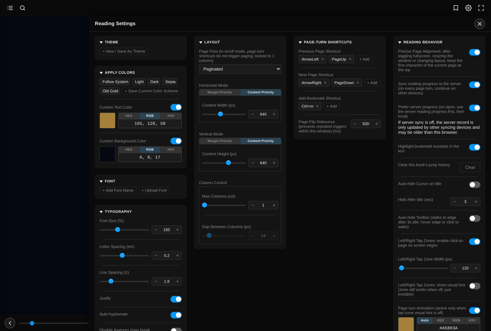
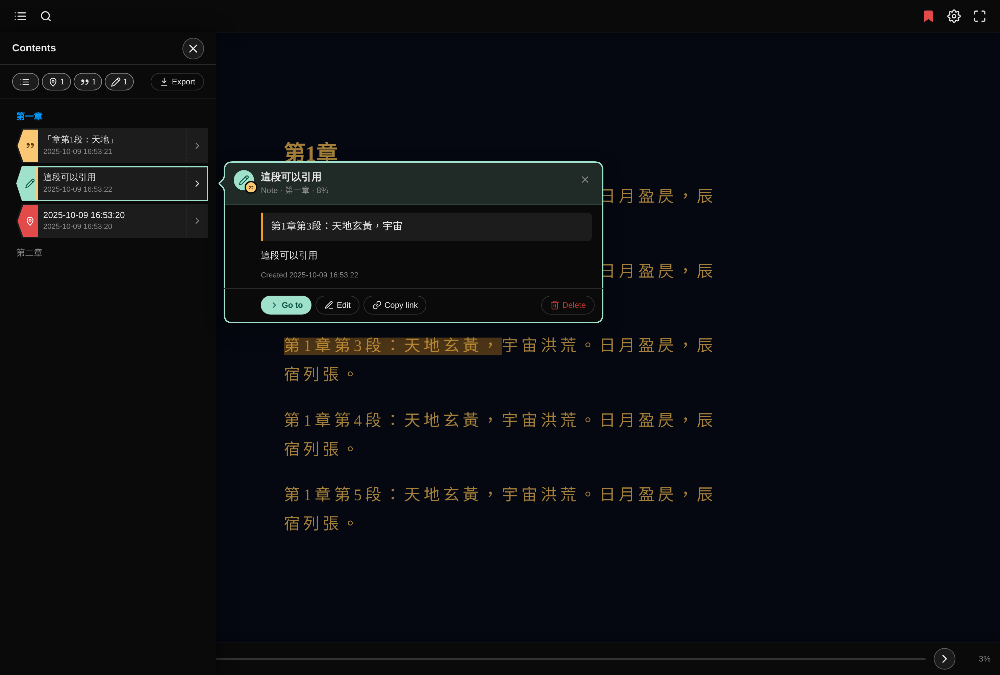

# calibre-web-foliate-mod

**English** | [繁體中文](README.zh.md)

A Tampermonkey userscript that replaces Calibre-Web's built-in, epub.js-based reader with a self-packaged [foliate-js](https://github.com/johnfactotum/foliate-js) reader. The interface supports Traditional Chinese and English, switching automatically based on your browser's language, with a manual override available in the settings.

> Developed and tested against [linuxserver/docker-calibre-web](https://github.com/linuxserver/docker-calibre-web). If you don't want to install the userscript, or your browser can't run Tampermonkey (e.g. on iOS), use the [Docker image](#cant-or-dont-want-to-install-the-userscript-use-the-docker-image) instead.

## Why this exists

Calibre-Web's built-in epub.js reader has limited typography controls (font size, letter spacing, line spacing, and margins are either missing or imprecise), and its interface can't be customized. Without touching Calibre-Web's server-side code, this script uses Tampermonkey to swap out the reader entirely on the browser side, replacing it with foliate-js, which offers much finer typography control and deep visual customization — while keeping Calibre-Web's existing bookmark sync and reading-progress mechanisms intact, so your usual workflow (bookmarks, progress) stays the same; only the rendering engine and interface change.

## Features

### Bookmarks: positions, excerpts and notes

- **Add a bookmark** with the bookmark button on the toolbar or **Ctrl+M**. Selected text becomes the excerpt; you can also write a note and a name (leave it empty to name it automatically). When the current page already has a bookmark, the toolbar icon turns red.
- **Three types**: **Position** (red) only marks a place, **Excerpt** (amber) has selected text, and **Note** (teal) has a note — with a small quote badge when it also has an excerpt. While adding or editing, the dialog's frame changes color live to show which type will be saved.
- **In the table of contents**, bookmarks sit under their chapter with a flag that shows the type. The filter buttons on top show only chapters or one bookmark type, with a count for each. Click a bookmark to jump to it; click › on its right — or, with a mouse, just hover — to open a detail card with **Go to**, **Edit**, **Copy link** and **Delete**.
- **In the text**, excerpts are highlighted with a soft background (can be turned off). Tapping a highlight opens the table of contents at that bookmark.
- **Storage**: the Tampermonkey version keeps bookmarks in Tampermonkey's storage; the Docker version keeps them on the server, tied to your Calibre-Web account, so they follow you across devices.

### Search

- The magnifier on the toolbar. Search the text, the bookmarks (names, excerpts and notes), or both.
- Case-insensitive, treats full-width and half-width characters as the same, and **matches Traditional and Simplified Chinese** (searching 書籤 also finds 书签).
- Results are grouped by chapter with surrounding text, position and highlighted keywords. Click a result to jump there; every match in the text is highlighted too.

### Export

- **Export** above the table of contents saves this book's bookmarks as **HTML** (formatted, ready to read or print), **Markdown** or **CSV**, optionally only the types currently filtered. Each entry includes a position link that opens the book right at that spot.

### Position links (preview mode)

- **Copy link** on a bookmark card gives an address that points at that exact character. Opening a book with it enters **preview mode**: it jumps to that spot **without changing your reading progress**. A notice at the top lets you choose **Start reading here** to make it your new reading position.

### Reading progress

- **Always saved locally** on every page turn.
- **Sync reading progress to the server** (on by default): every page turn is synced back to Calibre-Web so you can continue on another device; anything not yet sent is sent when you leave the page.
- **Prefer server progress** (on by default): on open, use the server's progress first, then the local one.
- With precise alignment on, the saved character is placed at the top of the page when the book opens.

### Jump history (back / forward)

- Jumps from the table of contents, bookmarks, in-book links (such as footnote `[284]`), search results and dragging the progress bar all go into **one** history. Use **↩ Back** and **↪ Forward** at the top right of the toolbar (the number shows how many steps are left); up to 99 steps are kept (the number shows "99+" once older ones start being removed); the Back button flashes each time a jump is recorded.
- If a jump happens while the toolbar is auto-hidden, a small ↩ ↪ ✕ group floats at the top right so you can get back from a footnote quickly. ✕ only hides it; the history stays.
- Clear this book's jump history under "Reading Behavior" in the settings. With precise alignment on, back and forward return to the first character of that page.

### Typography

- **Font size** 70%–300%, **letter spacing** −0.05em–0.5em, **line spacing** 1×–5×.
- **Justify** and **auto-hyphenate** toggles.
- **Disable ligatures** turns off OpenType ligature substitution. Some fonts use ligatures to convert text (common in display-level Traditional/Simplified Chinese conversion fonts); with custom letter spacing, certain words can look tighter than the text around them. Turning this on evens the spacing, at the cost of the font's substitution features.

> [!TIP]
> Every number field accepts typing, and the **− / +** buttons on either side step the value (hold to repeat). Focus a slider or a number box to fine-tune with the arrow keys or the mouse wheel.

### Layout

- **Page flow**: paginated or scrolled.
- **Horizontal / vertical mode**: margin priority (fixed margins) or content priority (fixed content width / height; margins absorb the rest, so the content keeps its size when you go fullscreen or rotate the screen).
- **Columns**: maximum columns and the gap between them in paginated mode; scrolled mode is always one column.
- **Defaults for first-time users** are calculated per device to look like an e-reader: one column; on computers and tablets, content priority with a content box and font size based on the screen (the farther away you read, the more characters per line); on phones, the text fills the screen. Letter and line spacing follow the interface language: 0.2em and 1.8 for Chinese, 0 and 1.5 for other languages. Everything can be adjusted afterwards.

### Themes and colors

- **Themes** save typography, layout and colors under a name for one-click switching; reorder by dragging or overwrite with current settings.
- **Apply colors**: built-in Follow System, Light, Dark, Sepia and Old Gold, plus your own saved schemes; one click fills the custom text and background colors below.
- **Custom colors**: separate switches for text and background (off uses the book's own colors), HEX / RGB / HSV input and a color picker.
- The toolbar and panels switch between dark and light to match the page's actual background.

### Fonts

- Type the name of an installed font, or upload a font file (.ttf / .otf / .woff, stored in the browser's IndexedDB). Reorder the list by dragging.

### Page turning and shortcuts

- Shortcuts for previous page, next page and add bookmark are customizable, with several keys per action (defaults: ← and Page Up, → and Page Down, Ctrl+M). **Page-turn debounce** prevents accidental double turns.
- The mouse wheel turns pages too. While the settings panel is open, shortcuts and the wheel adjust setting values instead.
- **Left/right tap zones**: tap the left or right side to turn pages; the width is adjustable and the visual hint is a separate switch. On computers this is a click zone; **on phones and tablets it works by gesture** — a tap turns the page, while a long press still selects text (even inside the tap zone), and the blank margins outside the content box work too.
- **Page-turn animation**: an arrow plays on the tap zone when turning pages; its color is customizable or follows the text color.

### Fullscreen and auto-hide

- **Fullscreen**: when the browser does not support web fullscreen (for example some third-party browsers on iOS 15), the button is shown disabled and explains why when tapped. In fullscreen on iPad Safari, the toolbar moves aside for the system ✕ button. Editing a bookmark in fullscreen on iPad brings up the on-screen keyboard, which makes the system leave fullscreen; fullscreen is restored when the dialog closes.
- **Auto-hide toolbar** and **hide cursor on idle** are off by default and can be turned on in the settings.

### Interface

- **Loading indicator**: large books show "Loading" with a download percentage instead of a blank screen. The book starts downloading as soon as the page opens, in parallel with loading the reader itself.
- **Settings panel**: columns adapt to the available width and the header stays fixed while scrolling; all icon buttons share one size and style.
- **Language**: Traditional Chinese or English based on the browser's preferred content language, or set manually at the bottom of the settings (reload to apply).

## Error log (Docker version)

"Save error logs to the server", downloading and clearing logs need a server, so they are **only in the Docker version**; the Tampermonkey version's settings panel does not show this section. To turn it on, check logs when the reader will not open, or report a problem, see [the calibre-web-foliate-docker README](https://github.com/bgtsai/calibre-web-foliate-docker#when-something-goes-wrong-error-logs-and-reporting).

## Can't or don't want to install the userscript? Use the Docker image

If you'd rather not install this userscript, or your browser can't run Tampermonkey (for example, browsers on iOS), use the Docker image instead: **[calibre-web-foliate-docker](https://github.com/bgtsai/calibre-web-foliate-docker)**.

The image builds this reader directly into Calibre-Web on the server side, so no browser extension is needed: every device that opens an EPUB on that Calibre-Web instance (desktop, phone or tablet) gets the new reader automatically.

- **Image**: `ghcr.io/bgtsai/calibre-web-foliate-docker:latest`
- Based on [linuxserver/docker-calibre-web](https://github.com/linuxserver/docker-calibre-web) and used the same way: just replace the image in your existing compose file (config and library paths stay the same). See that repo's README for a full compose example.
- The reader is built from this repo's source, so the features are the same; the differences are that settings are stored in the browser's `localStorage`, bookmarks and jump history are stored on the server, and there is a server-side error log.
- **Having both installed is fine**: the Tampermonkey version (v1.80.5 or later) detects that this Calibre-Web is already the Docker build and stops itself.

## Requirements

You'll need the [Tampermonkey](https://www.tampermonkey.net/) browser extension (works with Chrome, Firefox, Edge, and other major browsers). Visit the link above and follow the installation steps shown for your specific browser — the regular stable release works fine.

## Usage

1. Install Tampermonkey (see above).
2. Install this script: [calibre-web-foliate-mod.user.js](https://raw.githubusercontent.com/bgtsai/calibre-web-foliate-mod/main/calibre-web-foliate-mod.user.js) (Tampermonkey shows its install page; later versions update automatically)
3. Open any EPUB in Calibre-Web — the reader will automatically switch to the foliate-js version. Click the gear icon in the top-right corner to open the settings panel.

## Interface language not as expected?

The interface defaults to Traditional Chinese or English based on your browser's reported "preferred language for web content" — if it starts with `zh`, Chinese is shown; otherwise English. This setting is independent of your browser's own UI language (menus, buttons, etc.) — a browser with a Chinese interface doesn't necessarily report Chinese as the preferred web content language. If the auto-detected result isn't what you want, you can:

- Go to the "語言 / Language" section at the bottom of the settings panel and manually set the display language (a page reload is required for the change to take effect); or
- Adjust your browser's "preferred language for web content" setting (in Firefox: Settings → General → Language → Choose your preferred language for displaying pages, and move Traditional Chinese to the top of the list).
