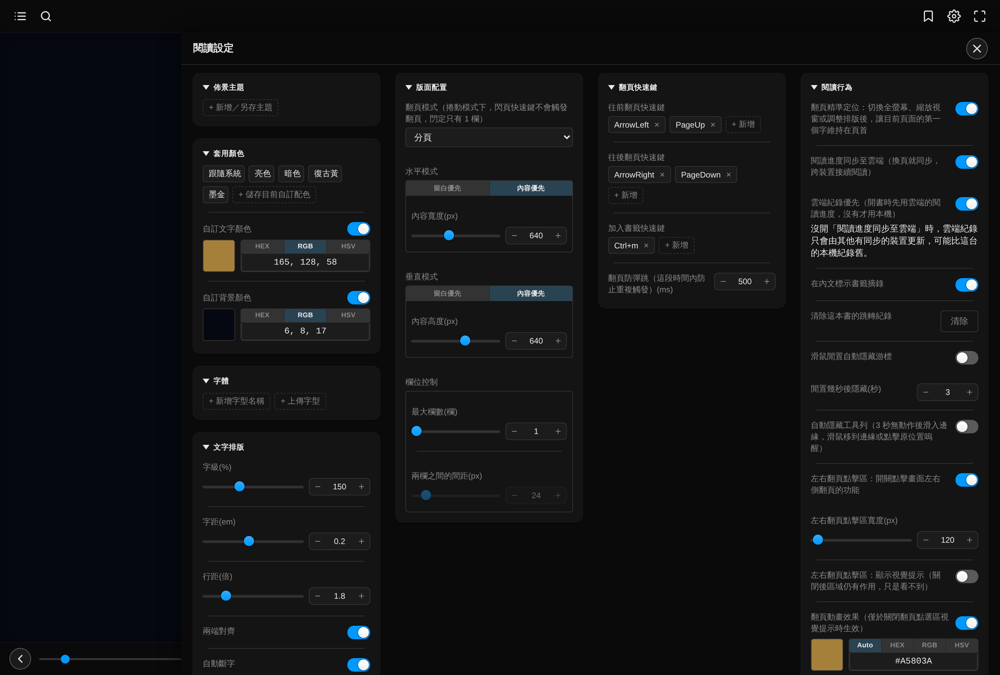
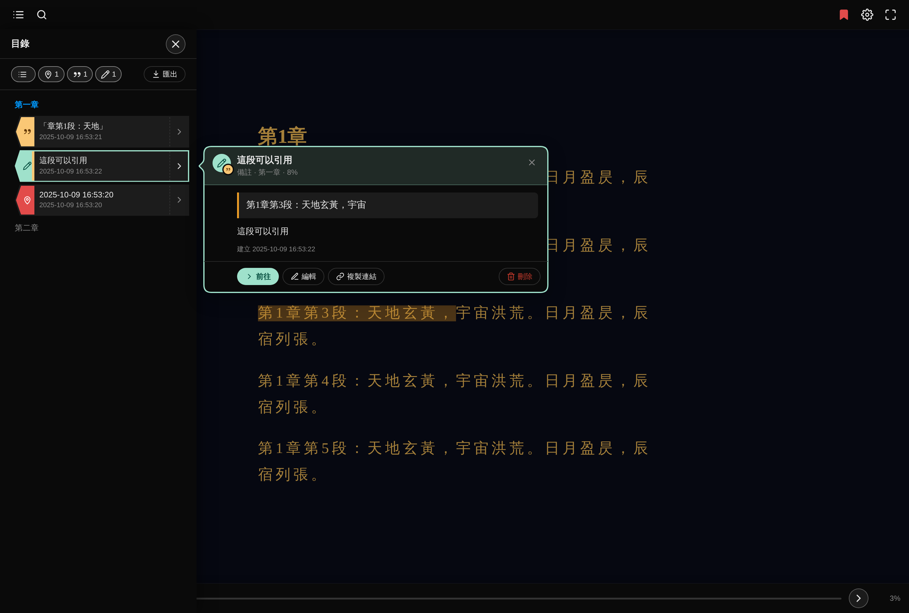

# calibre-web-foliate-mod

[English](README.md) | **繁體中文**

一支 Tampermonkey 使用者腳本，把 Calibre-Web 內建、基於 epub.js 的閱讀器，換成自己包裝的 [foliate-js](https://github.com/johnfactotum/foliate-js) 閱讀器。介面支援繁體中文／英文，依瀏覽器語言自動切換，設定裡也可以手動指定。

> 本腳本針對 [linuxserver/docker-calibre-web](https://github.com/linuxserver/docker-calibre-web) 開發與測試。不想安裝腳本或瀏覽器無法安裝 Tampermonkey（例如 iOS）時，請改用 [Docker 鏡像版](#不想裝腳本或瀏覽器無法安裝-tampermonkey改用-docker-鏡像)。

## 這是為了什麼寫的

Calibre-Web 內建的 epub.js 閱讀器，排版控制項有限（字級、字距、行距、留白這些細部排版選項都沒有或不夠精準），介面樣式也沒辦法自訂。這支腳本在不改動 Calibre-Web 伺服器端程式碼的前提下，用 Tampermonkey 在瀏覽器端把閱讀器整個換掉，改用排版控制更細緻、可以深度自訂外觀的 foliate-js，同時盡量保留 Calibre-Web 原本的書籤同步、閱讀進度這些既有機制，讓使用者原本習慣的操作方式維持不變，只是排版引擎跟介面換了。

## 功能說明

### 書籤：定位、摘錄、備註

- **加入書籤**：工具列的書籤鈕或 **Ctrl+M**。有選取文字時會帶入成「摘錄」，可以另外寫「備註」、自訂名稱（留空就自動命名）。這一頁已經有書籤時，工具列的書籤圖示會變成紅色。
- **三種類型**：只記位置的**定位**（紅）、有選取文字的**摘錄**（琥珀）、有寫備註的**備註**（青綠；同時有摘錄時會多一個引號小徽章）。新增或編輯時，對話框的外框顏色會跟著內容即時變成存下去的類型。
- **在目錄裡**：書籤插在所屬章節底下，用左側尖角的旗頭表示類型。上方的篩選鈕可以只看章節或某一類書籤，數字是該類的數量。點書籤本體直接跳過去；點右側 › 或（有滑鼠時）滑鼠移上去，會在旁邊彈出詳細卡片，可以〔前往〕〔編輯〕〔複製連結〕〔刪除〕。
- **在內文裡**：有摘錄的書籤會在內文用淡底色標示（可在設定關閉），點標示會打開目錄並指到那張書籤。
- **儲存**：Tampermonkey 版存在 Tampermonkey 的儲存空間；Docker 版存在伺服器，跟著 Calibre-Web 帳號走，換裝置也看得到。

### 搜尋

- 工具列的放大鏡。可以只搜內文、只搜書籤（名稱、摘錄、備註），或全部一起搜。
- 不分大小寫、全形半形視為相同，而且**簡繁互通**（例如搜「書籤」也找得到「书签」）。
- 結果依章節分組、附前後文與位置百分比，關鍵字標亮；點結果跳過去，內文所有命中處也會標示出來。

### 匯出

- 目錄上方的〔匯出〕，可以把這本書的書籤匯出成 **HTML**（排好版、可直接閱讀或列印）、**Markdown** 或 **CSV**，並可只匯出目前篩選的類型。每筆都附「定位連結」，點了會直接打開到那個位置。

### 定位連結（預覽模式）

- 書籤卡片的〔複製連結〕會產生一條指到「那一個字」的網址。用這條網址開書會進入**預覽模式**：直接跳到該位置，但**不會改動你的閱讀進度**；畫面上方會提示，按〔正式閱讀〕才把這裡當成新的閱讀位置。

### 閱讀進度

- **本機一律記錄**，每次換頁就記住位置。
- **閱讀進度同步至雲端**（預設開）：每次換頁就同步回 Calibre-Web，換裝置也能接著讀；離開頁面時會把還沒送出的進度補送。
- **雲端紀錄優先**（預設開）：開書時先用雲端的進度，沒有才用本機的。
- 開書時，進度所在的那個字會對齊在頁首（翻頁精準定位開啟時）。

### 跳轉紀錄（上一步／下一步）

- 從目錄、書籤、書內連結（例如註解 `[284]`）、搜尋結果跳轉，或拖動進度條，都記在**同一份**紀錄裡，用工具列右上的 **↩ 上一步**、**↪ 下一步** 來回（圖示上的數字是還能走幾步），最多保留 50 筆。
- 工具列自動隱藏時才發生的跳轉，畫面右上角會浮出一組小的 ↩ ↪ ✕，方便在看註解時跳回原處；按 ✕ 只是收起來，紀錄還在。
- 清除這本書的跳轉紀錄在設定面板的「閱讀行為」。翻頁精準定位開啟時，每次上一步／下一步都會回到當時頁面的第一個字。

### 文字排版

- **字級**：70%～300%。**字距**：−0.05em～0.5em。**行距**：1 倍～5 倍。
- **兩端對齊**、**自動斷字**：開關切換。
- **關閉連字**：停用字型的 OpenType 連字替換。適用於用連字機制做文字轉換的字型（常見於顯示層簡繁轉換字型）——這類字型搭配自訂字距時，特定詞彙的字距可能明顯比周圍窄；開啟後字距均勻，代價是字型的替換功能會一併停用。

> [!TIP]
> 所有數值欄位都可以直接輸入，也可以用兩側的 **−／＋** 增減（按住可連續增減）。點一下滑桿或數值框取得焦點後，也能用方向鍵或滑鼠滾輪微調。

### 版面配置

- **翻頁模式**：分頁或捲動。
- **水平／垂直模式**：留白優先（固定留白）或內容優先（固定內容寬度／高度，留白自動吸收剩餘空間，切換全螢幕、旋轉螢幕時內容大小不變）。
- **欄位控制**：分頁模式下設定最大欄數與欄間距；捲動模式固定 1 欄。
- **第一次使用的預設排版**會依裝置自動算出接近電子閱讀器的樣子：單欄；電腦與平板用「內容優先」、依螢幕大小決定內容框與字級（越遠看的裝置一行放越多字）；手機則填滿畫面。之後可以隨意調整。

### 佈景主題與配色

- **佈景主題**：把排版、版面與顏色另存成具名主題，一鍵切換，可拖曳排序、覆蓋更新。
- **套用顏色**：內建跟隨系統、亮色、暗色、復古黃、墨金，加上自己存的配色；點一下就把文字色與背景色填入下方自訂欄位。
- **自訂顏色**：文字與背景各一個開關（關閉就用書本自己的顏色），支援 HEX／RGB／HSV 與取色器。
- 工具列、面板會依書頁實際的背景色自動切換深色或淺色。

### 字型

- 可輸入系統已安裝的字型名稱，或直接上傳字型檔（.ttf／.otf／.woff，存在瀏覽器的 IndexedDB）。清單可拖曳排序。

### 翻頁與快速鍵

- 上一頁／下一頁、加入書籤的快速鍵都可自訂，每個動作可錄多組按鍵（預設：← 與 Page Up、→ 與 Page Down、Ctrl+M）。**翻頁防彈跳**避免連續誤觸。
- 滑鼠滾輪也能翻頁。設定面板開著時，快速鍵與滾輪改用來調整設定數值。
- **左右翻頁點擊區**：點畫面左右兩側翻頁，寬度可調，可另外決定要不要顯示提示框。電腦上是一塊點擊區；**手機、平板上改用手勢判斷**——點一下才翻頁，長按照樣可以選字（翻頁區範圍內也可以），內容框外的留白也能點。
- **翻頁動畫**：翻頁時在點擊區播放方向箭頭，顏色可自訂或跟隨文字色。

### 全螢幕與自動隱藏

- **全螢幕**：瀏覽器不支援網頁全螢幕時（例如 iOS 15 上的部分第三方瀏覽器），按鈕會顯示成停用，點了會說明原因。iPad Safari 全螢幕時，工具列左側會讓開系統的 ✕ 按鈕。在 iPad 全螢幕中編輯書籤時，螢幕鍵盤出現會讓系統退出全螢幕；關閉對話框時會自動回到全螢幕。
- **自動隱藏工具列**、**滑鼠閒置自動隱藏游標**：預設都關閉，可在設定開啟。

### 介面

- **載入提示**：打開大本的書時，畫面會先顯示「正在載入書籍」與下載百分比，不會只看到一片空白。書檔會在頁面一打開就開始下載，跟閱讀器程式的載入同時進行。
- **設定面板**：依可用寬度自動分欄，捲動時標題列固定；所有圖示按鈕同一套尺寸與樣式。
- **語言**：依瀏覽器的網頁內容偏好語言自動顯示繁體中文或英文，也可在設定最下方手動指定（需重新整理）。

## 錯誤紀錄（Docker 版）

「出錯時記錄到伺服器」、下載與清除錯誤紀錄需要伺服器端，**只有 Docker 版有**；Tampermonkey 版設定面板裡不會出現這一區。Docker 版的錯誤紀錄怎麼開、閱讀器打不開時怎麼查看、怎麼回報問題，請看 [calibre-web-foliate-docker 的說明](https://github.com/bgtsai/calibre-web-foliate-docker/blob/main/README.zh.md#出問題時錯誤紀錄與回報)。

## 不想裝腳本，或瀏覽器無法安裝 Tampermonkey？改用 Docker 鏡像

如果你不想安裝這支腳本，或是使用的瀏覽器沒辦法安裝 Tampermonkey（例如 iOS 上的瀏覽器），建議改用 Docker 鏡像版：**[calibre-web-foliate-docker](https://github.com/bgtsai/calibre-web-foliate-docker)**。

鏡像版已經把這個閱讀器直接內建在 Calibre-Web 裡，裝在伺服器端，不需要在任何瀏覽器安裝外掛；凡是連到這台 Calibre-Web 的裝置（電腦、手機、平板）打開 EPUB，都會直接使用新的閱讀器。

- **鏡像位置**：`ghcr.io/bgtsai/calibre-web-foliate-docker:latest`
- 以 [linuxserver/docker-calibre-web](https://github.com/linuxserver/docker-calibre-web) 為基礎，用法相同：把原本 compose 裡的 image 換成上面這個即可（設定檔、書庫路徑不用改）。完整的 compose 範例請見該 repo 的 README。
- 閱讀器程式直接取自本 repo 的原始碼，功能與本腳本相同；差別是設定改存在瀏覽器的 `localStorage`，書籤與跳轉紀錄存在伺服器，另外多了伺服器錯誤紀錄。
- **兩個都裝也沒關係**：Tampermonkey 版（v1.80.5 以上）偵測到這台 Calibre-Web 已經是 Docker 版，會自動停止，交給 Docker 版。

## 安裝需求

需要安裝 [Tampermonkey](https://www.tampermonkey.net/) 瀏覽器擴充功能（Chrome、Firefox、Edge 等主流瀏覽器皆可）。前往上面連結，依照頁面上針對你使用的瀏覽器提供的安裝步驟操作即可，一般穩定版本就可以正常運作。

## 使用方式

1. 安裝 Tampermonkey（見上）。
2. 安裝這支腳本：[calibre-web-foliate-mod.user.js](https://raw.githubusercontent.com/bgtsai/calibre-web-foliate-mod/main/calibre-web-foliate-mod.user.js)（點開後 Tampermonkey 會跳出安裝畫面；之後有新版本會自動更新）
3. 在 Calibre-Web 開啟任一本 EPUB，閱讀器會自動替換成 foliate-js 版本，右上角齒輪圖示可以開啟設定面板。

## 介面語言顯示不符預期？

介面預設依瀏覽器回報的「網頁內容偏好語言」自動判斷（開頭是 `zh` 就顯示繁體中文，其他一律顯示英文）。這組設定跟瀏覽器本身的**介面顯示語言**（選單、按鈕這些）是兩個各自獨立、可以不一樣的設定。如果自動判斷的結果不是你要的，可以：

- 到設定面板最下方的「語言 / Language」分組，手動指定要顯示的語言（切換後需要重新整理頁面才會生效）；或
- 調整瀏覽器本身「網頁內容偏好語言」的設定（以 Firefox 為例：設定 → 一般 → 語言 → 選擇偏好語言以顯示網頁，把繁體中文排到清單最上面）。
